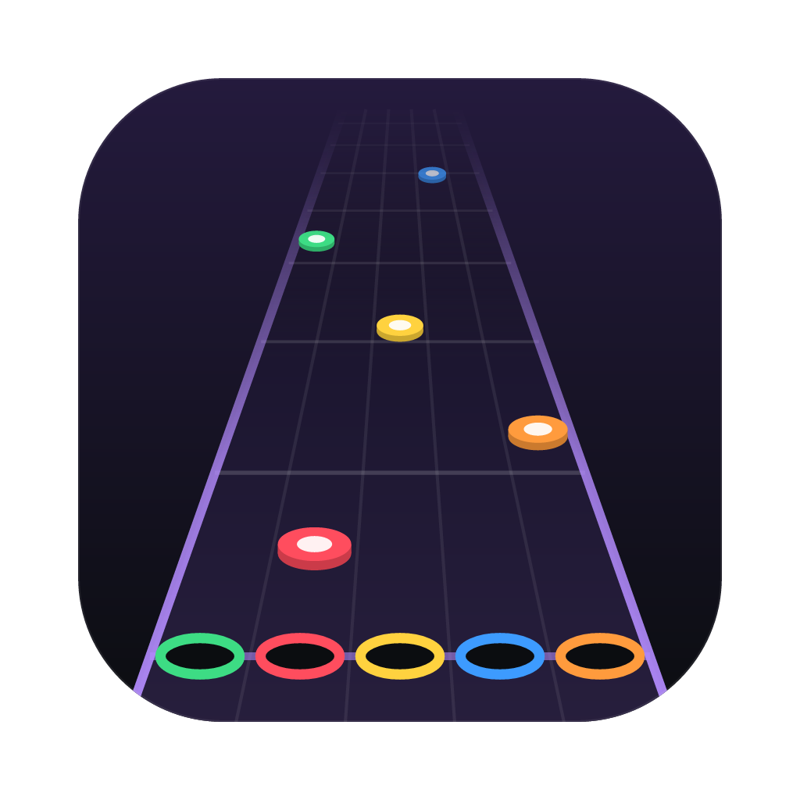
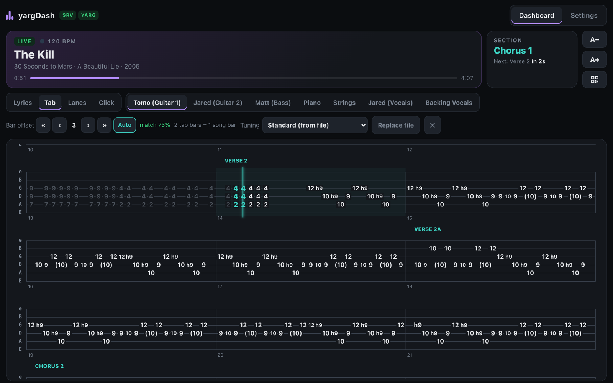
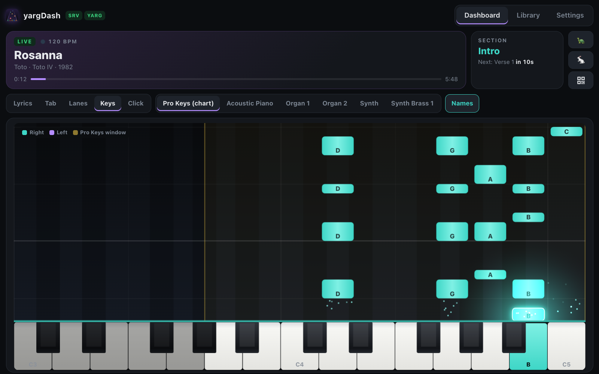
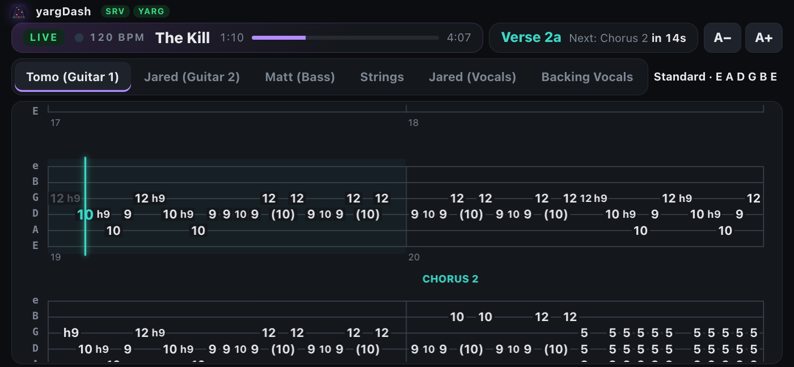
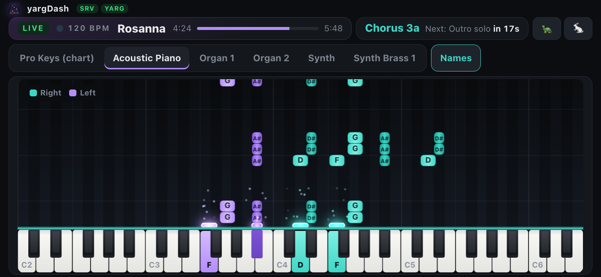
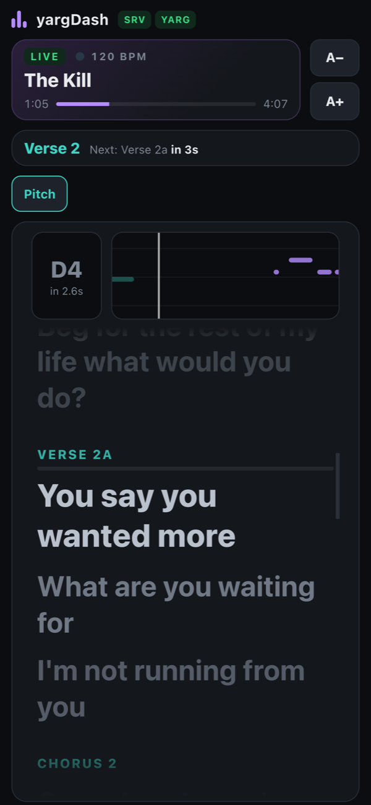

<p align="center"></p>

<h1 align="center">yargDash 🎸</h1>

<p align="center"><b>A live dashboard for your YARG band night</b> 🤘<br><a href="https://github.com/lilBadWolf/yargDash/releases/latest">⬇️ Download the app</a> · <a href="#-using-it">📖 What it does</a> · <a href="#-troubleshooting">🛟 Help</a></p>

A live dashboard for a running [YARG](https://yarg.in) game. Run it on the computer that runs YARG and open it on any phone, tablet or screen on the same network:

- 🎤 **Lyrics** that follow the song, with every harmony part and a pitch guide
- 🎸 **Tabs**: guitar and bass tablature in time, from the chart's Pro Guitar/Bass or a Guitar Pro file that lines itself up with the song
- 🛣️ **Lanes**: every part's note highway side by side, made for a screen facing the audience
- 🎹 **Keys**: the keyboard part falling onto piano keys, from the chart's Pro Keys or a Guitar Pro file's piano, organ or synth. Plug in a MIDI keyboard to see what you play, and light-up keyboards light the notes to play
- 🥁 **Click**: a big beat counter for the drummer
- 🏆 **Scores**: the band's result after each song, and your best during it
- 📚 **Library**: browse and search every song, see what's in it and whether its tab lines up
- 🛒 **Encore**: search Chorus Encore for more charts and download them straight into YARG's song folder, seeing which ones you already have
- 🎧 **Practice**: play any song's audio on the YARG computer while YARG is closed, and follow its tabs and charts: loop a section, slow it down, mute your part
- 📱 **Performer pages**: a QR code opens any of these on a phone with no controls

✨ It doesn't change YARG. It reads the song YARG is playing and the song file itself, and follows YARG's UDP data stream for timing. Works on macOS, Windows and Linux.

> [!NOTE]
> yargDash is an independent project, not made by or affiliated with YARG or its developers.


| Lyrics with the pitch guide | Tab, lined up with the song |
|---|---|
|  |  |
| **Keys: the part falling onto piano keys** | **Click for the drummer** |
|  |  |
| **Tab performer page on a phone** | **Keys performer page on a phone** |
|  |  |

## 🎛️ Real amps and mics too? Meet Live Console

If your band plays real instruments alongside YARG, check out yargDash's big sibling, [**Live Console**](https://github.com/lilBadWolf/reaper-xair-live-console). It's for setups where [REAPER](https://www.reaper.fm) runs your amp sims, drum samplers and vocal effects, and a **Behringer X Air** mixer (XR18, X18, XR16, XR12, MR18) is the audio interface and stage mixer. From any phone or tablet you get:

- 🎚️ faders and meters for what the audience hears, and LINE/USB per channel
- 🎸 effect presets by tapping a name, and whole-song sound recalls with sections (Intro, Verse, Solo…)
- 📋 songs and setlists
- 🎧 monitor mixes, and a QR code that gives each musician their own channel on their phone
- 🎮 a YARG tab with everything yargDash does, plus **auto-loading your sound for the song YARG starts**

🤝 They run side by side: when yargDash is running, Live Console finds it and gets YARG through it, so both show the same song, lanes and tabs.

## 🧰 Requirements

> [!TIP]
> 🎁 **Just want to play?** Grab the [desktop app](https://github.com/lilBadWolf/yargDash/releases/latest): no Node.js, no terminal. The steps below are for running it from source.

- [Node.js](https://nodejs.org) 18 or later (22.13 or later for scores)
- YARG on the same computer
- macOS, only if your Mac blocks YARG's data stream (see below): Apple's command line tools (`xcode-select --install`)

## 🚀 Install and run

```sh
git clone https://github.com/lilBadWolf/yargDash.git && cd yargDash
npm install
npm start
```

💡 No git? Download the ZIP from GitHub (*Code → Download ZIP*), unzip it and run the two `npm` commands in that folder.

`npm start` builds the page if needed and starts the server in the background on port **8900**, then prints the address to open, e.g. `http://192.168.1.116:8900/`. The server keeps running after the terminal closes. Its log is `data/yargdash.log`.

Run `npm start` again after updating: it rebuilds the page and restarts the server only if its code changed. Other commands:

| | |
|---|---|
| `npm start -- --port 8901` | use another port (remembered) |
| `npm start -- --foreground` | run the server in this terminal (Ctrl+C stops it) |
| `npm run restart` | restart the running server |
| `npm run yarg` | start YARG with the fix, for Macs that block its data stream |
| `npm run dev` | develop with hot reload (needs the server running) |

*Settings → Restart server* does the same as `npm run restart`. It only shows on the YARG computer.

### 🖥️ Desktop app

yargDash also comes as an app for macOS, Windows and Linux, so you don't need Node.js or a terminal. **Download it from [Releases](https://github.com/lilBadWolf/yargDash/releases/latest).** It runs the same server and shows the dashboard in its own window. Closing the window keeps it running in the menu bar (macOS) or tray (Windows/Linux), so phones stay connected. That icon's menu shows the address for phones (click to copy). On a Mac it also has **Start YARG**, which starts YARG with the fix for Macs that block its stream, without needing Apple's command line tools. It also has *Open at login*, *Restart server*, *Check for updates* and *Quit*.

- 🍎 **macOS**: `yargDash-<version>-mac-arm64.dmg` (Apple Silicon) or `-mac-x64.dmg` (Intel). The app is signed with yargDash's own certificate, not Apple's. That lets macOS remember its *Local Network* permission (needed to hear YARG) from one version to the next. The first time, macOS refuses to open it: go to *System Settings → Privacy & Security* and click **Open Anyway**. If macOS says it's damaged, run `xattr -cr /Applications/yargDash.app` in Terminal. Allow incoming connections and local network access when asked, or phones can't reach it and the stream can't reach yargDash.
- 🪟 **Windows**: `yargDash-Setup-<version>.exe`. SmartScreen may warn about an unknown publisher: *More info → Run anyway*. Allow it through the firewall on *private* networks when asked.
- 🐧 **Linux**: the `.AppImage` (make it executable) or the `.deb`.

🔄 **Updates**: on Windows and with the Linux AppImage, a new version downloads by itself and installs when the app quits (or choose *Restart to update* in its menu). On macOS and with the `.deb`, the app tells you when there's a new version and opens its download page. macOS only lets apps signed with an Apple Developer ID replace themselves.

📁 The app keeps its settings and Guitar Pro files in its own folder (*Show data folder* in its menu, or *Settings → Tab library*), not in `data/`. To back up your tabs, copy or zip its `tabs` folder; to restore them, copy it back while the app is closed. To bring your tabs over, copy `data/tabs/` and `data/config.json` into that folder while the app is closed. If a server started with `npm start` is already running on the same port, the app uses that one instead.

🛠️ To build it yourself:

| | |
|---|---|
| `npm run app` | run the app from this folder (uses `data/`, like `npm start`) |
| `npm run dist` | package it for this computer's OS into `release/` |
| `npm run icons` | redraw the icons (`scripts/make-icons.mjs`) |

Windows installers have to be built on Windows: the installer tool doesn't run on Apple Silicon Macs without Rosetta.

🚢 **Releasing** (GitHub Actions, `.github/workflows/release.yml`): bump `version` in `package.json`, write the release notes in `RELEASE.md`, and push to `main`. The workflow drafts release `v<version>`, builds on macOS, Windows and Linux, uploads the installers, and publishes the release once all three builds succeed. Installed apps then find the update. Pushes that don't change the version don't release anything. *Build desktop app* (run it from the Actions tab) makes test builds without releasing.

### 🎛️ YARG setup

- ✅ In YARG: *Settings → All Settings → Experimental → **Enable UDP Data Stream*** (once). Without it you still get the song and its lyrics, but nothing follows the song.
- 🍎 **On a Mac**, start YARG as usual. Some Macs refuse YARG's broadcast (YARG doesn't ask for the socket permission macOS can require; Windows doesn't check). *Settings → Connect YARG* tells you when that happens and offers ▶️ **Restart YARG with the fix**: yargDash starts YARG with a tiny library that adds that permission (`yarg/broadcast-fix.c`; YARG's files aren't changed). From a terminal: `npm run yarg`. The fix only applies when YARG starts. YARG broadcasts its data stream without the socket permission macOS requires (Windows doesn't check), so macOS blocks it. The launcher loads a tiny library into YARG that adds that permission (`yarg/broadcast-fix.c`; YARG's files aren't changed). Quit YARG first: the fix only applies when YARG starts.
- 📂 YARG installed somewhere unusual, or started with a custom data path? Enter the folder that contains `currentSong.json` in *Settings → YARG*.

## 🎶 Using it

The header shows **SRV** (the page is connected to the server) and **YARG** (green: running with the data stream on; yellow: running without it). The dashboard has five views. **Library** lists YARG's songs and **Settings** (tabs: *General*, *Library*, *Keys & MIDI*) shows what's connected and walks you through setting up YARG. Every view keeps your place: switch to the Library and back, or from the bass tab to the lyrics and back, and it's where you left it (a tab goes back to the top when YARG starts the song again).

### 🎤 Lyrics

Every line of the song with the current one near the top, syllables lighting up as they're sung, section headings, and a countdown before each entry. Pick **Lead / Harmony 1–3** per device. **Pitch** shows the notes coming up and names the one to sing. Lyrics a bit early or late on one device (e.g. a slow phone)? *Settings → Lyrics timing*.

### 🎸 Tab

Guitar and bass tablature in time, laid out in bars like a printed tab, with a cursor and the current row near the top.
- Songs whose chart has **Pro Guitar/Bass** (Rock Band 3 songs) have it automatically.
- For any other song, on the YARG computer (these buttons only show there), tap **Find tab** while it's playing. A song with Pro parts can get a Guitar Pro file too: its tracks then show next to the chart's. Ultimate Guitar's search for the song's Guitar Pro tabs opens in the browser. Pick one and download it: a Guitar Pro file that lands in *Downloads* and matches the song (by the title in the file, or the file name) is added by itself. Or tap **+ Guitar Pro file** and pick a `.gp`, `.gpx`, `.gp5`, `.gp4` or `.gp3` file. Tabs are kept in `data/tabs/`. Files named `Artist - Title.gp5` dropped in that folder are found too.
- A Guitar Pro tab lines up with the song by itself. It works out how the tab's bars relate to the chart's (a 3/4 tab against a 4/4 chart is fine), plays out its repeats, then places it **section by section** by matching its rhythm to the chart's guitar/bass notes and its section names to the chart's. A repeat the tab doesn't write out, an extra chorus or a skipped section only moves the parts after it. The Tab view shows how well it matches and what it adjusted. **Bar offset** nudges everything if needed: « » by a bar, ‹ › by a beat.
- **Tuning**: Guitar Pro files carry theirs, as do charts that record it. Many converted songs don't: the Tab view then marks the tuning *assumed* (standard) and lets you pick the right one (Drop D, E♭, Drop C…) per song and track. It only relabels the strings and is remembered for every device.

### 🛣️ Lanes

Every part of the song as a note highway, side by side (guitar, rhythm, bass, drums and keys at Expert, whichever the chart has), whether or not anyone is playing it in YARG, with the line being sung underneath. Shows hammer-ons and taps, open notes, sustains, star power, solos, and cymbals vs toms on pro drums. Pick which parts each device shows. 🐢 / 🐇 set the note speed.

### 🎹 Keys

The keyboard part falling onto piano keys in time with the song. Each key lights up while its note sounds: right hand teal, left hand purple. The keyboard spans the part's range, with note names on the notes and keys (**Names**) and the chord name when the file has one. 🐢 / 🐇 set the note speed.
- Songs whose chart has **Pro Keys** (Rock Band 3 songs) have it automatically, with the 17-key window Rock Band shows the player marked as it moves. Rock Band fits Pro Keys into two octaves, so it can sit an octave or more away from the real part.
- A Guitar Pro file's keyboard parts (piano, organ, synth, clavinet…) show here instead of in the Tab view, lined up with the song the same way as its tabs (and nudged by the same **Bar offset**). Newer `.gp`/`.gpx` files mark keyboards clearly, and their grand staff gives the two hands. In older formats every part has strings, so the instrument sound and track name decide. A part named for a voice, guitar, bass or harmonica stays a tab.
- ✨ **Effects** where notes reach the keys: Sparks, Flames, Beams, Ripples or Fireworks, with how drastic and which colours (the hands', fire, or a rainbow), and a separate one for when you play the right note. Pick them in *Settings → Keys & MIDI*, which previews them as you choose.

#### 🎹 MIDI keyboard

Plug a MIDI keyboard into the computer showing the Keys view (the yargDash app, or Chrome or Edge: Safari, iPhones and iPads can't use MIDI). It's used by itself on the YARG computer; **🎹 MIDI** on the Keys view turns it on or off.
- The keys you press show on the screen: amber, or outlined in white in the hand's colour when it's the right note. *Settings → Keys & MIDI* shows the last key it heard, to check a keyboard works.
- The Keys view shows **your keyboard's keys** (61 by default, or its size picked in Settings, with an octave shift for its octave buttons), so the screen matches where your hands go. Notes it doesn't have are dimmed, and a key you press off the screen is marked at the edge.
- 💡 **Key lights**: a keyboard with lights in its keys lights the notes to play, a moment before each one (200 ms, adjustable), in any view, even with the window in the background. **The ONE** keyboards (Smart Piano, Piano COLOR, Light Keyboard) are found and lit by themselves. Keyboards that light a key for each note they're sent (Casio's lighted-key models, some Yamaha and others) work too: pick the keyboard and its channel in Settings, and turn that channel down on it, as it may play the notes as well. The lights go off when the song ends. **Lights** on the Keys view turns them off and on, and *Test lights* in Settings runs up a scale.

### 🥁 Click

For the drummer: the beat in the bar (bar 1 highlighted), bar number and bars until the next section, timed from the chart. *Click sound* adds an audible click on that device.

### 🏆 Scores

After a song, the band score, stars and each player's result (from YARG's own scores), and during a song your best for it. YARG doesn't share the live score while playing.

### 📚 Library

Every song in the folders YARG reads (YARG's *Settings → Songs*), with album art. Search by title, artist, album, genre or year (press `/` to jump to the search box), filter (*Has tab* / *Needs a tab* for a Guitar Pro file, *Pro Guitar*, *Pro Bass* and *Pro Keys* in the chart, *Keys* for a Guitar Pro keyboard part, *Played*…) and sort. Each row shows the song's instruments (a dot marks a Pro part), whether it has a tab, and your best stars. Tap a song to see:
- its instruments with YARG's difficulty and note counts, vocal and harmony parts, sections and tempo
- its tab: the chart's Pro Guitar/Bass, or its Guitar Pro file and **how well that lines up** with the song (and what was adjusted). **Find tab** (on the YARG computer), **+ Guitar Pro file** and **Remove** work here without playing the song, and a downloaded tab is added to it by itself.
- the band's best score for it

`.sng` files, song folders with a `song.ini` and Rock Band CON packs (`*_rb3con` and the like, several songs per pack included) are listed. Packs with encrypted audio are left out, as YARG leaves them out. The list is rechecked every 10 minutes, or tap ⟳.

### 🛒 Get more from Encore

The Library's **Get more from Encore** side searches [Chorus Encore](https://www.enchor.us), the chart search for Clone Hero and YARG. Search for anything (song, artist, album, charter), or fill in **Artist** for every chart by that artist (with the search box as the song name), and pick an instrument if you like. More results load as you scroll. Each chart shows its charter, instruments, length and album art, and:
- ✅ **Downloaded**: this exact chart is already in your library (matched by name, artist and file size, so charts you got from the Encore website count too)
- 🔁 **In library**: you have the song, but as another chart or an older version

**Download** (on the YARG computer) saves the `.sng` into YARG's first song folder, named like Encore names it (`Artist - Name (Charter).sng`). Downloads run one at a time with a progress bar, and the Library picks them up by itself. YARG sees them after you rescan songs in YARG. *Settings → Encore downloads* shows the folder and can point downloads somewhere else (inside one of YARG's song folders). When a chart has a video background, the smaller file without the video is downloaded.

### 🎧 Practice

When YARG isn't running, a song in the Library has a ▶️ **Practice** button (on the YARG computer). It plays the song's own audio there and makes it the song shown, so the Tab, Keys and Lyrics views (and any performer page on a phone) follow it as if YARG were playing it. The Dashboard gets a transport bar:
- ⏯️ play/pause and seek (`Space` plays/pauses, `←` `→` skip 5 s)
- 🔁 jump to a section, or loop it
- 🐢 slow down to 50% (or up to 125%) without changing the pitch
- 🔇 mute any of the song's stems (Guitar, Bass, Drums, Vocals…) to play that part yourself

Lanes and Click are hidden while practising. Starting YARG ends practice. The audio comes from the song's stems (`song.ogg`, `guitar.opus`… in its folder or `.sng`). A Rock Band song's audio is one multichannel `.mogg`, which browsers can't play: the first time you practise one, yargDash splits it into a stem per instrument (a few seconds), kept for the last few songs in its data folder.

### 🎵 Menu music (macOS/Linux)

The song YARG plays in its menus shows too, with its lyrics. They follow the song when yargDash is sure it started from the top: when it follows the previous menu song, or is the first after YARG starts, or when you tap *Follow it*. YARG doesn't report pausing or skipping the menu music, so tap *Stop following* if you do.

### 📱 Performer pages

The QR button makes them: `#stage` lyrics, `#stage/harm2` a harmony part, `#tab/<track>` a tab, `#lanes` the lanes, `#keys/<track>` the keys, `#click` the click. They're compact on phones, in landscape too. Hold the logo for 1 s to get back to the dashboard.



## ⚙️ How it works

`server/server.mjs` is a small Node server (its only dependencies: [alphaTab](https://alphatab.net), to read Guitar Pro files, and a [Vorbis decoder](https://github.com/eshaz/wasm-audio-decoders), to practise Rock Band songs). It serves the page and pushes updates to every open page over Server-Sent Events.

- 💿 **Song**: YARG writes the song it's playing to `currentSong.json` in its data folder. The server reads everything else straight from the song file (`.sng`, a folder with `notes.mid` / `notes.chart`, or a Rock Band CON pack): lyrics and vocal notes, sections, the beat grid, every instrument part, and Pro Guitar/Bass.
- ⏱️ **Timing**: YARG doesn't broadcast its playback position, so the server works it out from the data stream. The clock starts at the chart's first tempo marker, stops while YARG is paused, and lines up with every bar line YARG reports (picking up song speed too). Each page runs the clock locally between updates.
- 🎵 **Menu music**: the file YARG has open, and when it started (YARG's log).
- 🛒 **Encore**: the server searches Encore's API and downloads from its file server, and remembers what it downloaded in `encore.json` in the data folder.
- 🎧 **Practice**: the page on the YARG computer plays the song's stems (served from the song file) and reports where it is; that drives the clock instead of YARG.
- 🎹 **MIDI keyboards**: the page reads the keyboard with Web MIDI and lights its keys with MIDI messages (for The ONE keyboards, as worked out by [open-one-piano](https://github.com/vhorvath2010/open-one-piano)). Nothing goes through the server.
- 🏆 **Scores**: YARG's own scores database.

| File | |
|---|---|
| `server/server.mjs` | HTTP server, SSE, endpoints (listed at the top of the file) |
| `server/yarg.mjs` | follows YARG: song, charts, data stream, clock, scores, menu music |
| `server/tabs.mjs` | Pro Guitar tabs, Guitar Pro files, lining them up, the Downloads watcher |
| `server/lanes.mjs` | the Lanes view's notes for every part |
| `server/library.mjs` | the Library: YARG's song folders, each song's details, album art and audio stems (for practice) |
| `server/encore.mjs` | searching and downloading charts from Chorus Encore |
| `server/con.mjs` | reading Rock Band CON packs: songs.dta, charts, album art, audio |
| `server/rbaudio.mjs` | splitting a Rock Band song's multichannel audio into stems for practice |
| `src/` | the page (Vue 3), built into one self-contained `dist/index.html` |
| `scripts/start.mjs` | `npm start`: build if needed, start or restart the server |
| `electron/` | the desktop app: window, tray, updates |
| `scripts/dist.mjs`, `scripts/make-icons.mjs` | packaging the app, drawing its icons |
| `yarg/` | the macOS data-stream fix and its launcher |
| `data/` | settings (`config.json`), Guitar Pro files (`tabs/`), the log. Not in git. `YARGDASH_DATA` or `--data` puts it elsewhere |

Several programs can follow YARG at once (the data stream is a broadcast), so yargDash can run alongside other tools on the same computer.

## 🛟 Troubleshooting

- 🔴 **SRV red**: the server isn't running or the page can't reach it. Run `npm start` on the YARG computer and check `data/yargdash.log`.
- 🟡 **YARG yellow / "Lyrics aren't following the song"**: the data stream is off in YARG. If *Settings* says macOS is blocking it, use ▶️ **Restart YARG with the fix** there.
- 🚧 **"Port 8900 is in use"**: another program uses it. `npm start -- --port 8901`.
- 🎹 **A MIDI keyboard's keys don't show** (*Settings → Keys & MIDI* never shows a *Last key*): turn the keyboard off and on. A keyboard's USB MIDI can stop sending until it's restarted.
- 📵 **Phones can't open the QR link**: they must be on the same network as the YARG computer. Set the address in *Settings → Phones & screens* if the auto-detected one is wrong (e.g. a VPN interface).
- 📡 **YARG yellow in the app on a Mac, though the stream is on**: macOS is keeping the app off the local network. Turn on **yargDash** in *System Settings → Privacy & Security → Local Network* and reopen it. Or tick *Send YARG's stream to this Mac only* in *Settings → Connect YARG* and restart YARG from there: the stream then stays on this Mac and needs no permission (but only one program on this Mac can receive it).
- 🔍 **Find tab doesn't pick up the download**: the file must land in *Downloads* and its title (or file name) must match the song. The first time, macOS may ask whether Node can use the Downloads folder: allow it. Or add the file with **+ Guitar Pro file**.

## 🔒 Security

Built for a trusted local network. The server has **no authentication**: anyone on the network can open the dashboard and change a song's tab. The Find tab and restart buttons only work from the YARG computer itself. Don't expose it to the internet.

## 📜 License

[MIT](LICENSE). Uses [Vue](https://vuejs.org) (MIT), [uqr](https://github.com/unjs/uqr) (MIT) and [alphaTab](https://alphatab.net) (MPL-2.0), installed by `npm install` under their own licenses.
