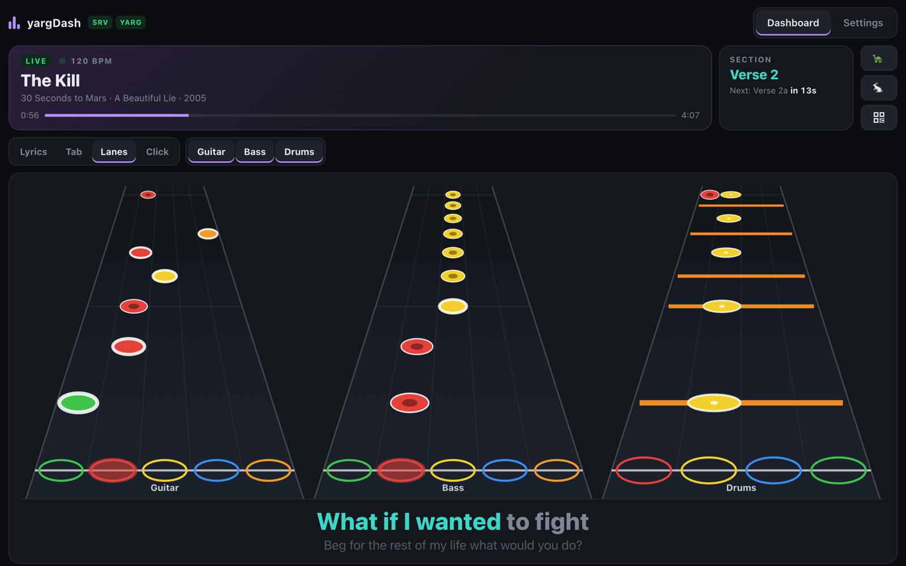
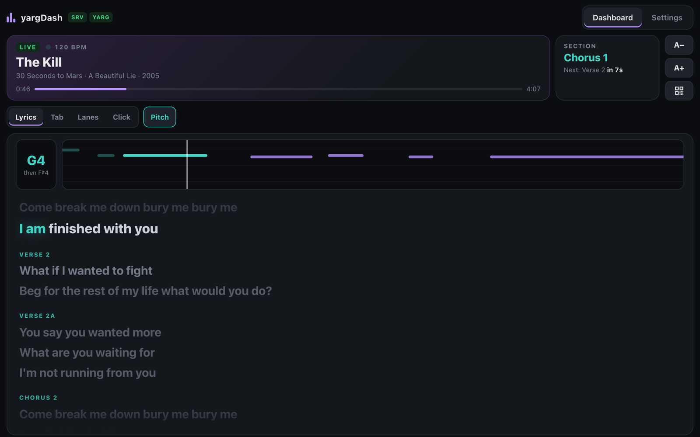
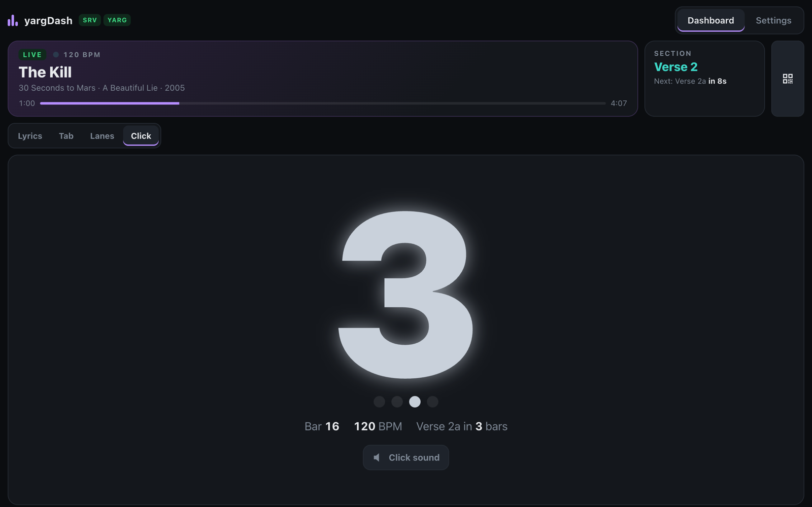

# yargDash

A live dashboard for a running [YARG](https://yarg.in) game. Run it on the computer that runs YARG and open it on any phone, tablet or screen on the same network:

- **Lyrics** that follow the song, with every harmony part and a pitch guide
- **Tabs**: guitar and bass tablature in time, from the chart's Pro Guitar/Bass or a Guitar Pro file that lines itself up with the song
- **Lanes**: every part's note highway side by side, made for a screen facing the audience
- **Click**: a big beat counter for the drummer
- **Scores**: the band's result after each song, and your best during it
- **Performer pages**: a QR code opens any of these on a phone with no controls

It doesn't change YARG. It reads the song YARG is playing and the song file itself, and follows YARG's UDP data stream for timing. Works on macOS, Windows and Linux.

yargDash is an independent project, not made by or affiliated with YARG or its developers.



| Lyrics with the pitch guide | Tab, lined up with the song |
|---|---|
|  |  |
| **Click for the drummer** | **Performer page on a phone** |
|  |  |

## Requirements

- [Node.js](https://nodejs.org) 18 or later (22.13 or later for scores)
- YARG on the same computer
- macOS: Apple's command line tools (`xcode-select --install`) for the data-stream fix, see below

## Install and run

```sh
git clone https://github.com/lilBadWolf/yargDash.git && cd yargDash
npm install
npm start
```

No git? Download the ZIP from GitHub (*Code → Download ZIP*), unzip it and run the two `npm` commands in that folder.

`npm start` builds the page if needed and starts the server in the background on port **8900**, then prints the address to open, e.g. `http://192.168.1.116:8900/`. The server keeps running after the terminal closes. Its log is `data/yargdash.log`.

Run `npm start` again after updating: it rebuilds the page and restarts the server only if its code changed. Other commands:

| | |
|---|---|
| `npm start -- --port 8901` | use another port (remembered) |
| `npm start -- --foreground` | run the server in this terminal (Ctrl+C stops it) |
| `npm run restart` | restart the running server |
| `npm run yarg` | start YARG with its data stream working on macOS |
| `npm run dev` | develop with hot reload (needs the server running) |

*Settings → Restart server* does the same as `npm run restart`. It only shows on the YARG computer.

### YARG setup

- In YARG: *Settings → All Settings → Experimental → **Enable UDP Data Stream*** (once). Without it you still get the song and its lyrics, but nothing follows the song.
- **On a Mac, start YARG with `npm run yarg`** (or double-click `yarg/Start YARG.command`) instead of the YARC Launcher. YARG broadcasts its data stream without the socket permission macOS requires (Windows doesn't check), so macOS blocks it. The launcher loads a tiny library into YARG that adds that permission (`yarg/broadcast-fix.c`; YARG's files aren't changed). Quit YARG first: the fix only applies when YARG starts.
- YARG installed somewhere unusual, or started with a custom data path? Enter the folder that contains `currentSong.json` in *Settings → YARG*.

## Using it

The header shows **SRV** (the page is connected to the server) and **YARG** (green: running with the data stream on; yellow: running without it). The dashboard has four views.

**Lyrics**: every line of the song with the current one near the top, syllables lighting up as they're sung, section headings, and a countdown before each entry. Pick **Lead / Harmony 1–3** per device. **Pitch** shows the notes coming up and names the one to sing. Lyrics a bit early or late on one device (e.g. a slow phone)? *Settings → Lyrics timing*.

**Tab**: guitar and bass tablature in time, laid out in bars like a printed tab, with a cursor and the current row near the top.
- Songs whose chart has **Pro Guitar/Bass** (Rock Band 3 songs) have it automatically.
- For any other song, on the YARG computer (these buttons only show there), tap **Find tab** while it's playing. Ultimate Guitar's search for the song's Guitar Pro tabs opens in the browser. Pick one and download it: a Guitar Pro file that lands in *Downloads* and matches the song (by the title in the file, or the file name) is added by itself. Or tap **+ Guitar Pro file** and pick a `.gp`, `.gpx`, `.gp5`, `.gp4` or `.gp3` file. Tabs are kept in `data/tabs/`. Files named `Artist - Title.gp5` dropped in that folder are found too.
- A Guitar Pro tab lines up with the song by itself. It works out how the tab's bars relate to the chart's (a 3/4 tab against a 4/4 chart is fine), plays out its repeats, then places it **section by section** by matching its rhythm to the chart's guitar/bass notes and its section names to the chart's. A repeat the tab doesn't write out, an extra chorus or a skipped section only moves the parts after it. The Tab view shows how well it matches and what it adjusted. **Bar offset** nudges everything if needed: « » by a bar, ‹ › by a beat.
- **Tuning**: Guitar Pro files carry theirs, as do charts that record it. Many converted songs don't: the Tab view then marks the tuning *assumed* (standard) and lets you pick the right one (Drop D, E♭, Drop C…) per song and track. It only relabels the strings and is remembered for every device.

**Lanes**: every part of the song as a note highway, side by side (guitar, rhythm, bass, drums and keys at Expert, whichever the chart has), whether or not anyone is playing it in YARG, with the line being sung underneath. Shows hammer-ons and taps, open notes, sustains, star power, solos, and cymbals vs toms on pro drums. Pick which parts each device shows. 🐢 / 🐇 set the note speed.

**Click**: for the drummer: the beat in the bar (bar 1 highlighted), bar number and bars until the next section, timed from the chart. *Click sound* adds an audible click on that device.

**Scores**: after a song, the band score, stars and each player's result (from YARG's own scores), and during a song your best for it. YARG doesn't share the live score while playing.

**Menu music** (macOS/Linux): the song YARG plays in its menus shows too, with its lyrics. They follow the song when yargDash is sure it started from the top: when it follows the previous menu song, or is the first after YARG starts, or when you tap *Follow it*. YARG doesn't report pausing or skipping the menu music, so tap *Stop following* if you do.

**Performer pages** (QR button): `#stage` lyrics, `#stage/harm2` a harmony part, `#tab/<track>` a tab, `#lanes` the lanes, `#click` the click. They're compact on phones, in landscape too. Hold the logo for 1 s to get back to the dashboard.


## How it works

`server/server.mjs` is a small Node server (no dependencies except [alphaTab](https://alphatab.net), to read Guitar Pro files). It serves the page and pushes updates to every open page over Server-Sent Events.

- **Song**: YARG writes the song it's playing to `currentSong.json` in its data folder. The server reads everything else straight from the song file (`.sng`, or a folder with `notes.mid` / `notes.chart`): lyrics and vocal notes, sections, the beat grid, every instrument part, and Pro Guitar/Bass.
- **Timing**: YARG doesn't broadcast its playback position, so the server works it out from the data stream. The clock starts at the chart's first tempo marker, stops while YARG is paused, and lines up with every bar line YARG reports (picking up song speed too). Each page runs the clock locally between updates.
- **Menu music**: the file YARG has open, and when it started (YARG's log).
- **Scores**: YARG's own scores database.

| File | |
|---|---|
| `server/server.mjs` | HTTP server, SSE, endpoints (listed at the top of the file) |
| `server/yarg.mjs` | follows YARG: song, charts, data stream, clock, scores, menu music |
| `server/tabs.mjs` | Pro Guitar tabs, Guitar Pro files, lining them up, the Downloads watcher |
| `server/lanes.mjs` | the Lanes view's notes for every part |
| `src/` | the page (Vue 3), built into one self-contained `dist/index.html` |
| `scripts/start.mjs` | `npm start`: build if needed, start or restart the server |
| `yarg/` | the macOS data-stream fix and its launcher |
| `data/` | settings (`config.json`), Guitar Pro files (`tabs/`), the log. Not in git. `YARGDASH_DATA` or `--data` puts it elsewhere |

Several programs can follow YARG at once (the data stream is a broadcast), so yargDash can run alongside other tools on the same computer.

## Troubleshooting

- **SRV red**: the server isn't running or the page can't reach it. Run `npm start` on the YARG computer and check `data/yargdash.log`.
- **YARG yellow / "Lyrics aren't following the song"**: the data stream is off, or (on a Mac) YARG wasn't started with `npm run yarg`.
- **"Port 8900 is in use"**: another program uses it. `npm start -- --port 8901`.
- **Phones can't open the QR link**: they must be on the same network as the YARG computer. Set the address in *Settings → QR codes* if the auto-detected one is wrong (e.g. a VPN interface).
- **Find tab doesn't pick up the download**: the file must land in *Downloads* and its title (or file name) must match the song. The first time, macOS may ask whether Node can use the Downloads folder: allow it. Or add the file with **+ Guitar Pro file**.

## Security

Built for a trusted local network. The server has **no authentication**: anyone on the network can open the dashboard and change a song's tab. The Find tab, add-file and restart buttons only work from the YARG computer itself. Don't expose it to the internet.

## License

[MIT](LICENSE). Uses [Vue](https://vuejs.org) (MIT), [uqr](https://github.com/unjs/uqr) (MIT) and [alphaTab](https://alphatab.net) (MPL-2.0), installed by `npm install` under their own licenses.
